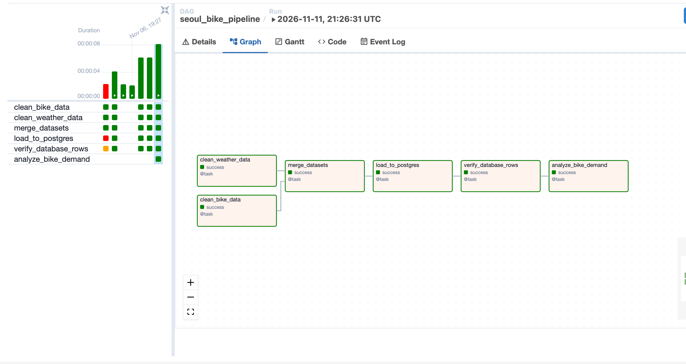
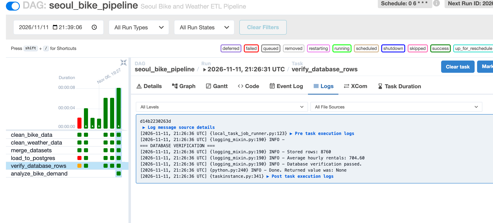
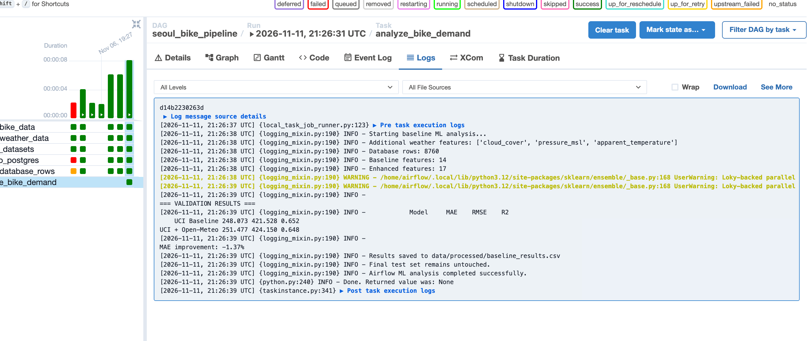
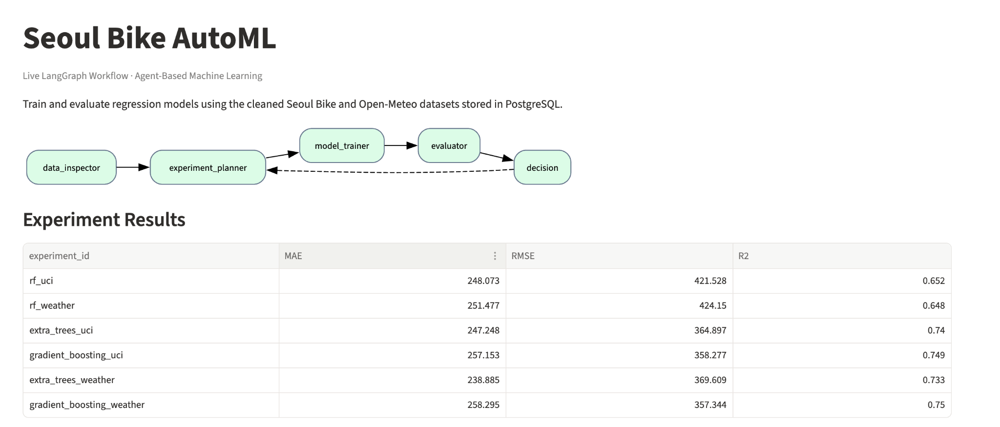
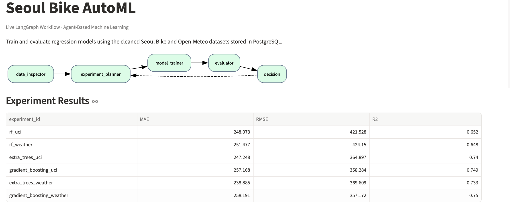
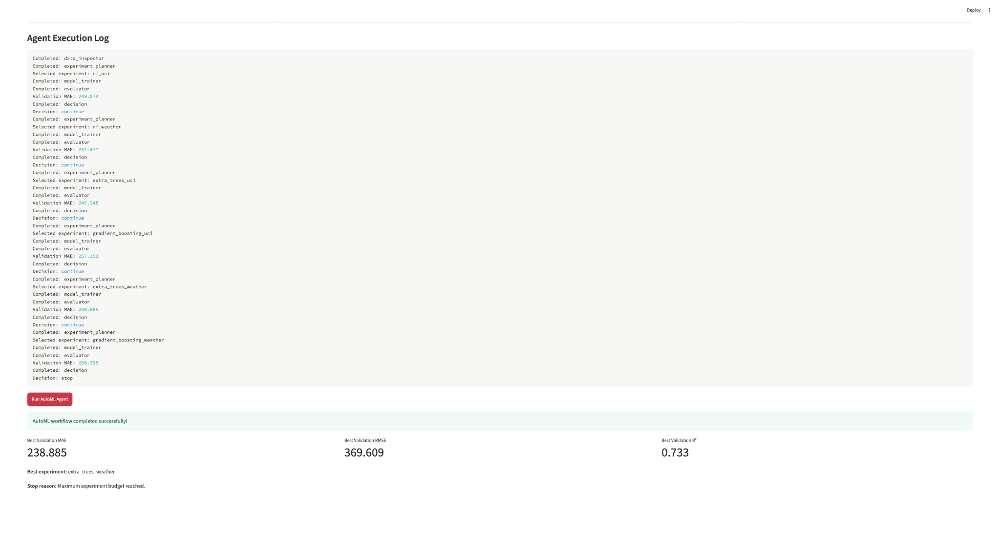

# Seoul Bike Demand Prediction — Airflow & Agent-Based AutoML

An end-to-end data engineering and agent-based machine learning project for predicting hourly bike-sharing demand in Seoul.

This project implements two workflows:

- **Part 1 — Apache Airflow:** A scheduled ETL pipeline that integrates two independent datasets, processes the data, stores it in PostgreSQL, and performs machine learning analysis.
- **Part 2 — LangGraph:** An iterative AutoML workflow that selects, trains, and evaluates regression models, with a live Streamlit dashboard displaying agent execution and model performance.

## 1. Project Objective

The primary goal is to predict hourly bike rental demand and investigate whether additional historical weather features improve prediction accuracy.

The project also demonstrates how Airflow handles structured data pipelines while LangGraph coordinates iterative machine learning experiments.

## 2. Data Sources

**Dataset 1: Seoul Bike Sharing Demand**

- Source: [UCI Machine Learning Repository](https://archive.ics.uci.edu/dataset/560/seoul+bike+sharing+demand)
- File: `SeoulBikeData.csv`
- Contains 8,760 hourly observations, bike rental counts, weather measurements, seasonal information, and holiday indicators.

**Dataset 2: Historical Weather Data**

- Source: [Open-Meteo Historical Weather API](https://open-meteo.com/en/docs/historical-weather-api)
- File: `seoul_weather.json`
- Additional variables: cloud cover, mean sea-level pressure, and apparent temperature.

**Time period:** December 1, 2017 – November 30, 2018.

Both datasets are aligned by hourly timestamps. The merged dataset contains **8,760 observations and 18 columns**, with no missing values after processing.

## 3. Part 1 — Airflow Data Pipeline

The Airflow DAG is implemented in `airflow/dags/seoul_bike_pipeline.py`.

**Pipeline tasks:**

1. `clean_bike_data` — Read and clean the UCI dataset.
2. `clean_weather_data` — Read and clean the Open-Meteo dataset.
3. `merge_datasets` — Join datasets using hourly timestamps.
4. `load_to_postgres` — Load the merged records into PostgreSQL.
5. `verify_database_rows` — Verify the number of stored observations and calculate average hourly rental demand.
6. `analyze_bike_demand` — Train and evaluate baseline regression models using data read from PostgreSQL.

The two data-cleaning tasks execute independently and can run in parallel. Downstream tasks wait for their upstream dependencies to succeed.

**Scheduling:** The DAG uses the cron schedule `0 6 * * *`, representing a daily run at 06:00 UTC.

The input is a fixed historical dataset. Scheduled runs reprocess the same historical observations rather than ingesting newly arriving records.

**Database verification:**

- Stored observations: 8,760
- Average hourly rentals: 704.60
- Database verification: Passed

### Airflow Baseline Analysis

Two Random Forest configurations were evaluated using the chronological validation set.

| Model | MAE | RMSE | R² |
|---|---:|---:|---:|
| UCI Baseline | 248.073 | 421.528 | 0.652 |
| UCI + Open-Meteo | 251.477 | 424.150 | 0.648 |

Adding the three external weather features did not improve the original Random Forest baseline.

## 4. Part 2 — LangGraph Agent-Based AutoML

The custom agent is implemented in the `agent/` directory and uses the processed data stored in PostgreSQL.

**Five workflow nodes:**

1. **Data Inspector:** Reads and validates the dataset, identifies available features.
2. **Experiment Planner:** Selects an untested model configuration using previous validation results and predefined selection rules.
3. **Model Trainer:** Trains the selected regression model and saves validation predictions.
4. **Evaluator:** Calculates MAE, RMSE, and R², and tracks the best-performing configuration.
5. **Decision:** Determines whether to continue experimenting or stop.

LangGraph conditional edges route the workflow back to the Planner when further experiments are required.

The workflow is **rule-driven**, with an experiment budget of six runs. It does not require an external LLM API.

### Models and Experiments

The agent compares three regression algorithms:

- Random Forest
- Extra Trees
- Gradient Boosting

Each algorithm is evaluated using two feature configurations:

- **UCI:** Original UCI features and derived calendar features.
- **Weather:** UCI features plus Open-Meteo variables.

The dataset is divided chronologically:

- Training: 70% (6,132 rows)
- Validation: 15% (1,314 rows)
- Final test: 15% (1,314 rows)

Preprocessing is fitted using training data only. The final test set is reserved for evaluation after selecting the model.

### Agent Validation Results

| Experiment | MAE | RMSE | R² |
|---|---:|---:|---:|
| Random Forest — UCI | 248.073 | 421.528 | 0.652 |
| Random Forest — Weather | 251.477 | 424.150 | 0.648 |
| Extra Trees — UCI | 247.248 | 364.897 | 0.740 |
| Gradient Boosting — UCI | 257.153 | 358.277 | 0.749 |
| Extra Trees — Weather | **238.885** | 369.609 | 0.733 |
| Gradient Boosting — Weather | 258.295 | **357.344** | **0.750** |

**Best model by validation MAE:** Extra Trees with additional weather features.

Its validation MAE is approximately **3.70% lower** than the original Random Forest UCI baseline.

Gradient Boosting with weather features achieved the lowest RMSE and highest R², illustrating how model selection depends on the evaluation objective.

Small numerical differences may occur across software environments.

### Final Holdout Evaluation

After model selection, the winning configuration was retrained using the combined training and validation observations and evaluated on the previously untouched chronological test set.

| Metric | Final Test Result |
|---|---:|
| MAE | 182.290 |
| RMSE | 286.449 |
| R² | 0.747 |

These results describe retrospective hourly demand prediction using observed historical weather. They should not be interpreted as a validated future forecasting system without additional experiments using forecast-available inputs.

## 5. Containerized Development Setup

**Requirements:** Docker Desktop and Docker Compose.

The project uses the following containers:

- PostgreSQL for cleaned bike-sharing data
- PostgreSQL for Airflow metadata
- Airflow Webserver
- Airflow Scheduler
- LangGraph + Streamlit Agent Dashboard

### Configuration

Clone the repository and create a local `.env` file:

```bash
git clone https://github.com/ThomasXu2026/IDS706_Mini-Assignment_with_Orchestration.git
cd IDS706_Mini-Assignment_with_Orchestration
cp .env.example .env
```

Edit `.env` and replace the example passwords with private values. Do not commit `.env` to Git.

### Prepare the Datasets

Create the input directories:

```bash
mkdir -p data/raw data/processed artifacts/agent
```

Download the original Seoul Bike dataset from the UCI source and save it as:

`data/raw/SeoulBikeData.csv`

To retrieve the Open-Meteo weather variables for the corresponding historical period, use:

```bash
curl -G "https://archive-api.open-meteo.com/v1/archive" \
  --data-urlencode "latitude=37.5665" \
  --data-urlencode "longitude=126.9780" \
  --data-urlencode "start_date=2017-12-01" \
  --data-urlencode "end_date=2018-11-30" \
  --data-urlencode "hourly=cloud_cover,pressure_msl,apparent_temperature" \
  --data-urlencode "timezone=Asia/Seoul" \
  --data-urlencode "models=era5" \
  -o data/raw/seoul_weather.json
```

The API response must contain an `hourly` object with the `time` field and the three weather variables. The pipeline checks that hourly observations match before loading them into PostgreSQL.

Historical weather data or model revisions may cause reproduced metrics to differ slightly from the documented results.

### Start the Containers

Build the images:

```bash
docker compose build
```

On a new installation, initialize Airflow and create its administrator account:

```bash
docker compose --profile setup run --rm airflow-init
```

Start the required services:

```bash
docker compose up -d
```

Check their status:

```bash
docker compose ps
```

**Airflow UI:** http://localhost:8090

**Agent Dashboard:** http://localhost:8502

The Airflow username is `admin`, with the password specified by `AIRFLOW_ADMIN_PASSWORD` in `.env`.

### Run Part 1

Open the Airflow UI, find `seoul_bike_pipeline`, enable the DAG, and select **Trigger DAG** to execute it manually.

Verify that all six tasks complete successfully.

### Run Part 2

After the Airflow pipeline has populated PostgreSQL, open the Streamlit Agent Dashboard at http://localhost:8502.

Select **Run AutoML Agent** to start the LangGraph experimentation loop.

The dashboard displays the agent graph, execution history, validation metrics, best experiment, and stopping condition.

For a command-line execution, run:

```bash
docker compose exec agent-dashboard python -m scripts.run_agent
```

For the selected model's separate final test evaluation:

```bash
docker compose exec agent-dashboard python -m scripts.final_test
```

The final test command is intended as a one-time reporting step after model selection, not as part of iterative tuning.

### Stop the Services

```bash
docker compose stop
```

Do not use `docker compose down -v` unless you intentionally want to delete the database volumes.

## 6. Project Structure

```text
seoul-bike-automl/
├── airflow/
│   └── dags/
│       └── seoul_bike_pipeline.py
├── agent/
│   ├── state.py
│   ├── nodes.py
│   └── graph.py
├── dashboard/
│   └── app.py
├── scripts/
│   ├── check_data.py
│   ├── prepare_data.py
│   ├── load_postgres.py
│   ├── baseline_ml.py
│   ├── run_agent.py
│   └── final_test.py
├── data/
│   ├── raw/
│   └── processed/
├── screenshots/
├── Dockerfile.airflow
├── Dockerfile.agent
├── docker-compose.yml
├── requirements-agent.txt
├── .env.example
└── README.md
```

## 7. Execution Screenshots

### Successful Airflow DAG Execution



### PostgreSQL Verification



### Airflow Model Analysis



### Live LangGraph Workflow



### Model Evaluation Results



### Agent Execution and Stop Decision



## 8. Key Findings

The project demonstrates successful coordination of data engineering and agent-based machine learning workflows.

Airflow processed two independent datasets through parallel cleaning tasks, merged the hourly observations, stored the results in PostgreSQL, and executed baseline model analysis.

LangGraph coordinated six regression experiments using conditional routing and historical validation feedback. Extra Trees with additional weather variables achieved the lowest validation MAE, improving on the original Random Forest baseline by approximately 3.70%.

The final selected model achieved a test MAE of 182.290 and an R² of 0.747.

The comparison also showed that adding more weather features does not necessarily improve every algorithm. Its effectiveness depended on the model configuration and evaluation metric.

## 9. References

- UCI Machine Learning Repository. *Seoul Bike Sharing Demand*. https://doi.org/10.24432/C5F62R
- Open-Meteo. *Historical Weather API*. https://open-meteo.com/en/docs/historical-weather-api
- Apache Airflow. https://airflow.apache.org/
- LangGraph. https://docs.langchain.com/oss/python/langgraph/
- Streamlit. https://streamlit.io/
